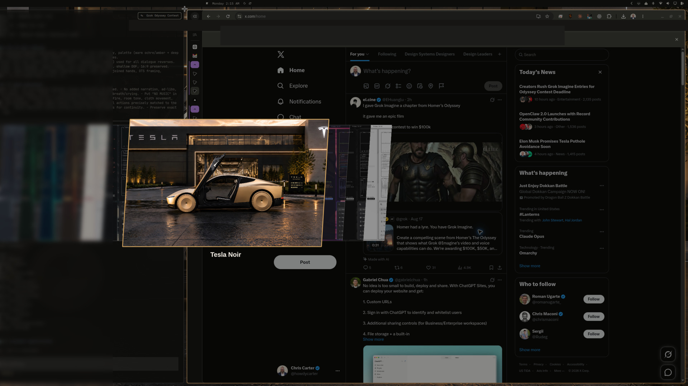

# Tesla Noir

Graphite cabin surfaces, champagne metal, and bone-colored type for
[Omarchy](https://omarchy.org/). The palette is sampled from the included
dusk showroom wallpaper: wet asphalt, warm architectural light, and
champagne bodywork.

Unofficial fan theme. Not affiliated with Tesla, Inc.



## Install

```bash
omarchy theme install https://github.com/howdycarter/omarchy-tesla-noir-theme
```

Then select **Tesla Noir** from the Omarchy theme menu
(`Super + Ctrl + Shift + Space`).

## Palette

| Token | Hex | Role |
|---|---|---|
| background | `#0D0D0C` | Graphite cabin |
| lighter_background | `#24211D` | Raised surfaces |
| accent | `#D2A35F` | Champagne |
| hyprland warm metal | `#C88F4B` | Focus / shadow |
| foreground | `#E7E2D9` | Bone |
| red | `#D36B5D` | Brake |
| green | `#91A578` | Sage |

Recommended font: `iA Writer Mono S`.

## Notes

- `colors.toml` is the source of truth. Omarchy regenerates terminal,
  Chromium, and most app themes from it on install.
- `hyprland.lua` adds a warm-metal gradient border, rounding, and a
  champagne shadow. The installer may regenerate Hyprland colors from
  `colors.toml`; copy this file into
  `~/.config/omarchy/themes/tesla-noir/` if you want the extra look.
- Wallpaper: `backgrounds/tesla-noir.jpg` (3840×2160).
